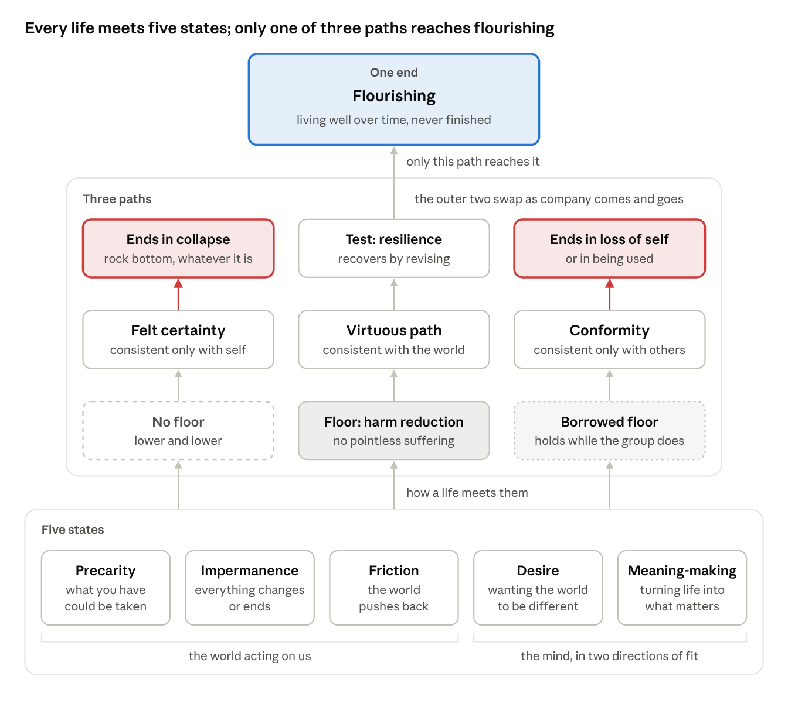

# Toward a Definition of Flourishing

A working framework for what it means to live well, for a person and for a society.

**Status:** working draft, revised as it's tested, so expect it to change. Last updated October 18, 2026.

## The short version

Five states every life faces, three paths for meeting them, one end.

- **Five states.** Three are the world acting on us: precarity, impermanence, and friction. Two are the mind: desire and meaning-making.
- **Three paths.** Felt certainty is consistent only with yourself; conformity, only with others. The virtuous path keeps beliefs open to revision and checks them against the world.
- **One end.** Flourishing: living well over time, never finished.

The full argument is in [the framework](framework.md). It rests on eight [axioms](axioms.md).

## What's here

| File | What it holds |
| --- | --- |
| [framework.md](framework.md) | The framework: the five states, meaning-making, freedom, virtue, worth, justice, and the floor a just society owes everyone |
| [axioms.md](axioms.md) | The eight axioms it rests on, from causation to the hypothetical imperative, plus freedom as a matter of degree |
| [axiom-revisions.md](axiom-revisions.md) | How each axiom has changed, and why |
| [uses-of-good.md](uses-of-good.md) | The many uses of the word "good," and where moral judgment fits among them |
| [ontology.md](ontology.md) | How things come to have functions, and why function supplies the standard |
| [questions.md](questions.md) | Open questions first, then resolved ones with their answers |
| [whos-who.md](whos-who.md) | Every person cited and what each contributes, starting with twelve |
| [CHANGELOG.md](CHANGELOG.md) | A dated record of public updates |

## How it was written

I've developed this framework over many long conversations with Claude, Anthropic's AI model. Much of the current prose was drafted with Claude, and I'm rewriting it in my own voice as I go.

## Push back

This is posted to find out where it breaks.

- **Disagree with something?** [Open an issue](../../issues/new) naming the section and the problem.
- **Have a better wording or a missing source?** Suggest the exact change with a pull request.
- **Want to see what changed?** Every revision is in the history, and changes to the axioms are explained in [Axiom revisions](axiom-revisions.md).

## License

© 2026 Greg Grimes. Shared under [CC BY 4.0](LICENSE): you can share and adapt it, with credit.
