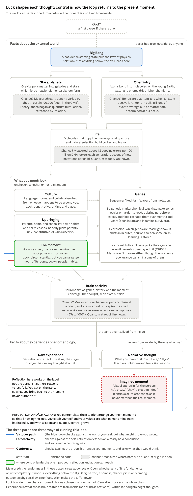

# Axioms

Eight axioms ground the framework, plus the framework's definition of freedom. Each has been revised for consistency with the others; what changed, and why, is on [Axiom revisions](axiom-revisions.md).

**The order.** Each axiom builds on the ones before it:

1. [Causation](#causation): every event has prior conditions.
2. [Interaction](#interaction): wherever there is a channel back, interaction runs both ways, though rarely evenly.
3. [Constraint](#constraint): everything that exists is limited, and rules are limits too.
4. [Emergence](#emergence): simple rules build levels with regularities of their own.
5. [Embodiment](#embodiment): mind is one such level; it needs a body beneath it and inherits the body's limits.
6. [Unbidden Thoughts and Desires](#unbidden-thoughts-and-desires): so thoughts and desires arrive from processes no one chose.
7. [Compression](#compression): minds organize what arrives into concepts.
8. [Hypothetical Imperative](#hypothetical-imperative): examining one of those concepts, "good," shows every value is relative to an end, so every moral claim is conditional.

## Causation

**Every event has prior conditions, which either determine it or constrain a genuinely random outcome. There is no third option.**

Ask of any thing or thought: why, what kind, how, where from. Each answer reveals further conditions; nothing originates from nothing. Agent-causal libertarianism collapses under "why did you do that?" Either a reason explains the act, at least partly, or it was random and not authored. "Sui generis" agent causation only names the gap between determinism and randomness.

Reasons can be mental or physical: thoughts beget thoughts, as a slap begets thoughts. Any consideration that contributes to an outcome counts, including habits, preferences, emotions, instincts, and reflexes.

**Causes can shift odds.** Many causes raise or lower the odds of an outcome rather than fix it; philosophers call this probabilistic causation. Whether the odds come from complexity no one can compute (see Emergence) or from genuine chance, at our scale they look the same.

**Chains can branch.** A random event starts a new branch mid-chain, so a chain doesn't always trace back to one origin.

*causation · the external world and experience, with chance an open question*

Many causes meet in each thought: standing conditions like genes, upbringing, and culture shift the odds, a trigger sets it off, and what you meet also writes on your genes. Every one traces back to the Big Bang, unless quantum chance enters somewhere, which remains an open question. The same events are also lived from inside, as facts about experience.

## Interaction

**Wherever there is a channel back, interaction runs both ways, though rarely evenly. Where there is none, contact runs one way.**

The moon orbits the Earth but also pulls on it, raising tides. So any God or unmoved mover still in relation to the world cannot be static, unchanging, or "perfect." The same holds for people: facilitating others' flourishing changes the facilitator, which is one reason justice includes oneself.

**Why contact can run one way.** One-way contact comes from having no channel back to the original entity, not from time itself. The past is one case: we can't change what Caesar did. A dead star is another: its light arrives after there is nothing left to reach. Light from a living star is different, since it tells us the star is there and where to find it, so a relation is possible. Some galaxies we can see are already out of reach, though: the universe's expansion carries them away faster than any signal we send could follow.

**Channels have widths.** Where a channel back exists, what varies is how much it carries. A conversation is wide both ways: each side hears the other's words and can be changed by them. Other channels carry far less coming back than going out.

**Broadcast is two-way but lopsided.** A news station speaks to millions in words, and viewers answer only in aggregate, through ratings, clicks, and ad money. The station responds, so the interaction is two-way, but the channel back carries a number, not a voice, and it rewards attention rather than fit (see How a meaning persists, on the main page). Viewers can also feel they know an anchor who doesn't know they exist, which Donald Horton and Richard Wohl called parasocial interaction (1956). It feels like a relation but never pushes back on the viewer, so it gives the self-story nothing to be tested against.

**Power widens the channel out and narrows the channel back.** Power is partly control over channels: the reach to broadcast, and the means to filter what comes back. Nothing forces the narrowing, but it tends to happen. Feedback is friction, and power is the means to avoid friction, through flatterers, press offices, and distance. Some studies find that even a brief feeling of power makes people worse at taking others' perspective (Adam Galinsky and colleagues, 2006). Insulated power drifts toward felt certainty: consistent only with itself, its self-story never tested. Lord Acton said power "tends to corrupt"; this is one way it does. Accountability rebuilds the channel back (see Power is a separate problem, on the main page).

**For minds, interaction is education, and education is interaction.** A rock in a stream interacts but doesn't learn; education is interaction that changes how a mind responds next time. Every ongoing interaction changes both parties, and whether the change is learning depends on how open the mind is. Felt certainty turns interaction into entrenchment, which is learned too: learning to resist rather than learning what's true. Psychologists call this motivated reasoning (Ziva Kunda, 1990). A process that doesn't respond to reasons can't be taught by them, and some change only surfaces later, after reflection. So the virtuous path is what makes interaction into education. John Dewey made interaction one of education's two principles (*Experience and Education*, 1938). Paulo Freire rejected the banking model, where teachers deposit knowledge and nothing flows back; in real education the teacher learns too (*Pedagogy of the Oppressed*, 1968). Education without a channel back is broadcast, and it mirrors the power structure above: "knowledge is power" (Francis Bacon) runs both ways.

## Constraint

**To exist is to be constrained.**

A random quantum event can only produce outcomes its wave function allows; no fluctuation produces the Eiffel Tower.

Change and finitude constrain every decision. Windows for action close, reasoning takes time, and mortality forces priorities. Even immortality would meet the heat death of the universe.

**Freedom from what?** Freedom as "free from all constraint" is incoherent. Freedom from interference by other people still makes sense. But the line between precarity and impermanence isn't who imposes a constraint: precarity comes from everything, natural and social, and can be reduced; impermanence cannot.

**Rules are constraints.** The rules of any system limit what can happen in it, and those limits are what let structure form. Emergence, next, shows what simple rules build.

## Emergence

**Simple rules give rise to complex behavior and structure, with regularities of their own at each level.**

Conway's Game of Life produces complex patterns from four rules governing pixels. Reality climbs the same way: particles, atoms, molecules, chemistry, electrochemistry, each level with its own behaviors. A quark is a richer pixel. It feels all four fundamental forces, comes in six flavors (up, down, charm, strange, top, bottom), and carries one of three color charges. It exists in 3D space and is only one type of matter.

Direction of thought: Conway's Life → a particle Game of Life → a 3D particle Game of Life.

**Weak emergence.** Higher levels arise entirely from lower-level rules, with no new causal powers overriding them; strong emergence would sneak agent causation back in. Mark Bedau's definition: a weakly emergent pattern is derivable from the underlying rules, but only by simulation; it has to be run. Everything is reducible, but not predictable. The Game of Life is Turing complete, so whether a pattern eventually dies out is undecidable in general. A real-world case: in a 2008 experiment, drivers circling a track at a steady speed spontaneously formed a traffic jam with no bottleneck, a pattern no single driver chose. Minds are weakly emergent too, which is why trying is how freedom learns about itself, and why verdicts on other minds call for humility.

## Embodiment

**Mind cannot exist, or be coherently conceived, without a physical structure beneath it.**

Even a Boltzmann brain needs physical structure. Brain and body support each other. Their structure is largely, not completely, set by genes; gravity, natural selection, sexual preference, disease, and physical activity shape it too.

Mind is a higher level in Emergence's sense, so it inherits the limits of the structure beneath it. The body supports thought and limits it: no one can imagine seeing ultraviolet without the eyes for it. Moving a mind to silicon would change its limits, not erase them.

**Mind as software.** The framework is physicalist and functionalist. Mental states are defined by what they do, not what they're made of, much as software is defined by what it runs rather than by the chip (Hilary Putnam). Experience is real the way software is real: it is what certain states are, from the inside. So Chalmers's zombie, a physical duplicate with no experience, is only seemingly conceivable, and consciousness stays weakly emergent. The analogy strains in one place. A program moves unchanged between machines, but a running mind changes its own hardware: learning rewires synapses, and body chemistry is part of the computation. Moving a mind would change it.

**Two kinds of facts.** Some facts are about the external world: anyone can check them from outside, like a neuron firing or a slap landing. Others are about experience: what the sting or the thought is like, known first by the one who has it. On this framework they are not two worlds but one set of events described two ways, from outside and from inside (see Mind as software). Thomas Nagel named the inside view as what it is like to be something ("What Is It Like to Be a Bat?", 1974). The framework needs both. Facts about the world test beliefs; facts about experience settle what only the subject can report, which is why only the sufferer can judge whether their suffering has a point.

**The mind can silence the body, for a while.** Mind and body interact the way ruler and ruled do (see the power paragraph under Interaction). The mind broadcasts orders, keep working, push through, and can narrow the channel back by tuning out tiredness, hunger, or pain. The sense of those signals is called interoception; it varies between people and can be trained. But the body keeps a veto the mind can't override forever. Stay awake long enough and sleep forces its way in, as microsleeps of a few seconds that no effort prevents. Push long enough and burnout, illness, or injury forces the channel open. That is rock bottom as a forced consistency, at the scale of one body. The pull runs the other way too: hunger, exhaustion, craving, and panic can take over the mind. Plato wanted reason to lead, but by agreement among the soul's parts, not by silencing them (*Republic* IV).

## Unbidden Thoughts and Desires

**One does not control the thoughts and desires that arise in one's head.**

Desires can conflict. An addict may want to use while also wanting not to want to. But forming a second-order desire is also outside conscious control; one can reflect on desires, not create them. So even the addict who wants to keep wanting got there by happenstance.

**What this rules out.** This defeats ultimate responsibility, not Frankfurt's structural account, which already allows that we don't author our desires. Reflection still shapes later desires indirectly, since thoughts beget thoughts.

**Control without authorship.** No one can summon a thought, but one can arrange the conditions that make it likelier. Someone who wants to be a drummer can sit in the studio, where drumming thoughts are more likely, though not guaranteed. A second-order desire, itself unbidden, gets its grip this way. The same control serves every path: someone who avoids anyone who disagrees is arranging their moments just as skillfully. The paths differ not in how much control one has but in what it answers to: the world, the self, or the group.

**Luck is wider than chance.** Something is luck for you when you didn't choose it, whether or not it was random, so even a fully determined world is full of luck. Thomas Nagel sorted it into four kinds ("Moral Luck," 1976; Bernard Williams raised the same problem in the same symposium):

- **Constitutive luck:** who you are. Genes, temperament, and what upbringing and culture made of them, down to the epigenetic marks that set which genes are read.
- **Circumstantial luck:** what you face. The era, the place, the slap, whatever happens to come up.
- **Causal luck:** everything upstream. The whole chain back to the Big Bang, which no one chose.
- **Resultant luck:** how things turn out. The same act can end well or badly for reasons outside it.

Attention doesn't escape it. What you notice depends on temperament and past learning, and what you notice then shapes you, so the loop itself runs on luck. Two things follow. Luck undercuts desert (see Luck undercuts desert, in [the framework](framework.md)), and it gives the floor its point: a just society insures people against the worst of the lottery. But luck is not the whole story, and the moment is where control starts. You can fill your moments with rooms, books, and people that shape you, and repeated, those moments become habits. Each gain in wisdom and nuance widens the options you can see and take, so control compounds (see Freedom as a matter of degree). It was luck that you could start, but from there, control grows.

## Compression

**Abstract concepts are compressions in minds, not residents of a Platonic realm.**

"Good," "justice," "beauty," "free will," "purpose," "time," and "meaning" compress loosely related concepts, drawn from lived experience and received from culture. Analyzing how the words are used reveals their structure. It also lets us seek precise definitions consistent with the other axioms, the method behind this framework's definitions of justice and flourishing.

One must be sympathetic to the Ancients. The stars really were the heavens to them: an unreachable realm, compressed into gods and stories because nothing else could make it navigable.

**Time.** Change and finitude are real constraints; "time" is our compression of them. Related: Wittgenstein's family resemblance, Carnap's explication.

**Meaning stays two-way.** Contact can run one way where there is no channel back (see Interaction), but meaning does not. Ideas and events from the past can be adopted, changed, expanded upon, or revised, whatever was intended. The meaning of a past event exists only as a compression in present minds, so present minds keep interacting with it.

- **Danto:** many true descriptions of an event can't be known when it happens. "The Thirty Years' War began in 1618" couldn't have been said in 1618.
- **Gadamer:** a text's meaning isn't settled by its author's intention; it develops through its history of interpretation.
- **Eliot:** each new work slightly rearranges the meaning of everything written before it.

**Facts are the floor under reinterpretation.** The facts of the past are fixed; their meaning is in play. The virtuous path revises meaning while staying faithful to the facts, as in the "redemption sequences" Dan McAdams found in life stories, where a painful event is retold as the start of something good. Felt certainty does the reverse, revising the facts to protect a meaning so the self was never wrong.

**Survival doesn't make a meaning better.** A meaning that survives is not thereby better than one that died. Societies with rich meanings have vanished, and we will never know of them. Which meanings survive depends heavily on luck, power, and who kept records, much as Levi said survival in the camps owed much to luck. Survival shows a meaning was carried forward, not that it was worth more. The resilience test compares ways of living across many shocks; it is not a verdict on the worth of any single meaning.

**The uses of "good."** The word compresses many uses, each tied to a different end: something is good as a kind, at an activity, for someone, toward an end, by someone's standard. Every evaluative use is end-relative, and the bare verdict, as in "what a good man," hides its standard. End-relativity is the next axiom, the Hypothetical Imperative. Full analysis: The uses of "good"

## Hypothetical Imperative

**All moral statements are hypothetical: they bind those who hold the relevant ends.**

A crack can be found in any "categorical" formulation. But some hypotheticals invoke near-universal responses, above all pointless suffering. The term names something one would always avoid if one could. What counts as suffering varies (torture, isolation, mutilation, a boring life, lack of autonomy), yet everyone has the capacity for it.

**Aversive, not avoided at any cost.** Suffering is aversive by definition, yet people rightly accept suffering for meaning. Suffering is also not failure to flourish. People can flourish while suffering, and fail to flourish without suffering.

**No ultimate Good.** If all moral statements are hypothetical, "good" is always good *for* or good *as* something; there is no ultimate Good standing apart from ends. Others have already made the linguistic case. Wittgenstein's "Lecture on Ethics" separates the relative sense of good (a good pianist, a good road to town) from an absolute sense he thought could not be meaningfully stated. Peter Geach's "Good and Evil" argues "good" works like "big": it needs a noun to attach to, as in a good knife or a good person. The uses of "good" are summarized under Compression, just above, and mapped in full on [their own page](uses-of-good.md).

## Freedom as a matter of degree

**Freedom is having achievable options, the power to take them, knowledge of both, and actions that track one's own reasons and desires, even though those were given.**

**Freedom is not free will.** Following Derk Pereboom's hard incompatibilism (*Living Without Free Will*, 2001), free will in the sense needed for ultimate moral responsibility, or basic desert, is incompatible with both determinism and genuine randomness. Hard incompatibilism takes no position on whether quantum events are truly random; it shows that neither option yields free will. What survives is freedom as a matter of degree, and forward-looking responsibility: protection, reconciliation, and moral growth. The word "free will" is rejected because in ordinary use it carries ultimate responsibility along with it; "freedom" is kept because range of choices and knowledge of them are real.

The axioms rule out libertarian freedom (Causation), freedom from all constraint (Constraint), and self-authored will (Unbidden Thoughts). Yet the framework needs freedom: capabilities are real freedoms. This account survives all three. Under full determinism, the faster and the starving person still differ: change the faster's reasons and they eat, while the starving person's reasons make no difference.

**Sources.** The definition is this framework's own synthesis, and each component has a lineage:

- **Options:** Amartya Sen's substantive freedom, meaning real opportunities rather than formal permissions.
- **Power:** Locke's definition of liberty as a power to act according to one's own mind, and Nussbaum's internal capabilities.
- **Knowledge:** Aristotle's epistemic condition (*Nicomachean Ethics* III): an act is fully voluntary only if it is neither forced nor done in ignorance.
- **Ownership:** Daniel Dennett's *Freedom Evolves* (2003), which builds freedom by degrees from the Game of Life, and John Martin Fischer and Mark Ravizza's *Responsibility and Control* (1998), on owning a reasons-responsive mechanism.

Together these match the classic control and epistemic conditions on agency, used here to define freedom by degree rather than to ground basic desert. Full treatment on the main page.

## How the axioms ground the framework

Which axioms each state or idea rests on.

| State or idea | Grounded in | How |
| --- | --- | --- |
| Precarity | Embodiment, Interaction, Constraint | A body can be harmed, and others act on it |
| Impermanence | Causation, Interaction, Constraint | Everything changes and is changed; nothing escapes finitude |
| Friction | Interaction, Constraint | Every aim meets a world that pushes back |
| Desire | Unbidden Thoughts, Embodiment | Desires arise uncontrolled, shaped by an evolved body |
| Meaning-making | Compression, Emergence | Minds compress experience into concepts; meaning emerges at a higher level |
| Ethics and justice | Hypothetical Imperative | Morality binds those who share its ends; suffering is the near-universal case |
