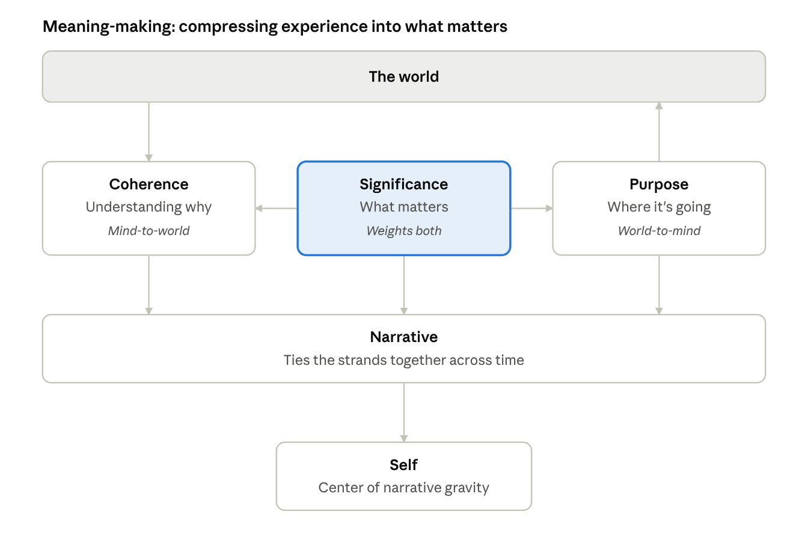
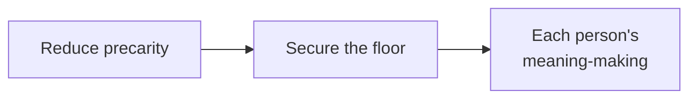
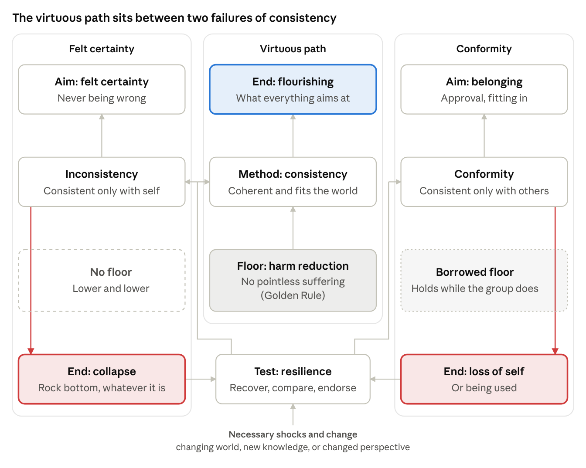
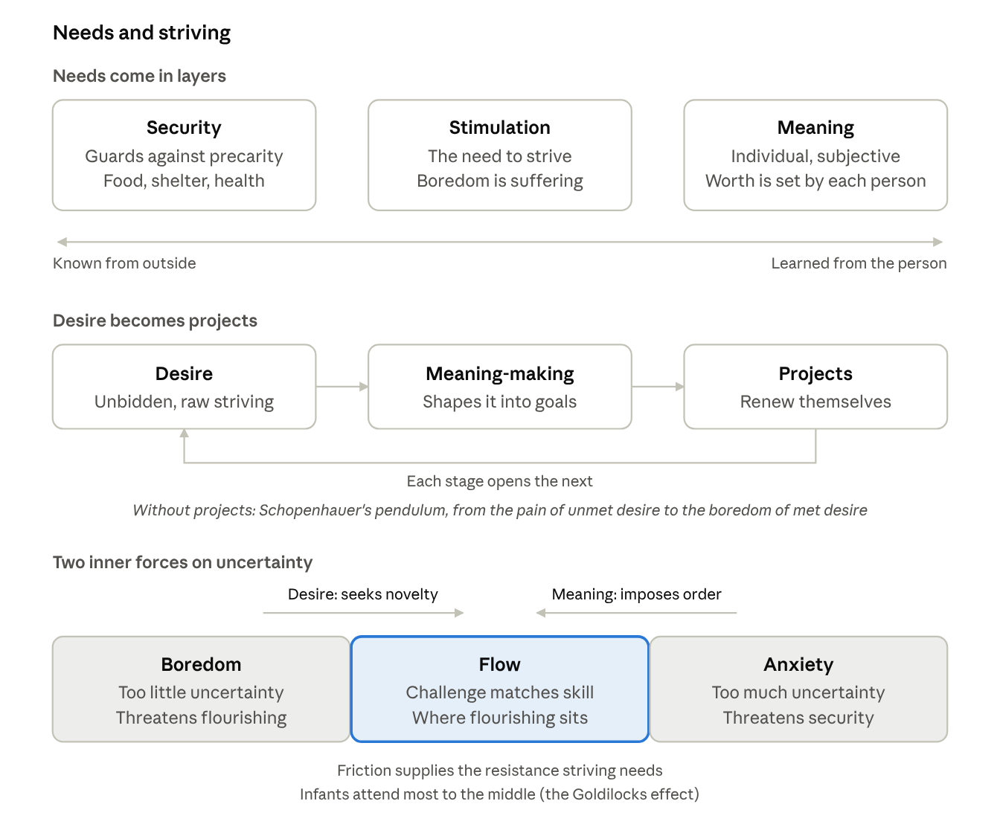

# Toward a Definition of Flourishing

Greg Grimes · Last updated October 18, 2026

*Working draft, revised as it's tested, so expect it to change.* Changes to the axioms are logged in [Axiom revisions](axiom-revisions.md).

**For persons and governments.** This is a framework for both. It follows Plato's analogy in the *Republic*: look at a just city to see what a just person is. The structure is the same at both scales, and the mechanisms differ (see Virtue at scale).

**Thesis.** Right and wrong exist only against a standard; this framework argues the standard, at the very least for humans, is the floor.

## Where the framework starts

Some positions can't be built on, because their founding claims undermine themselves. The framework doesn't try to refute them; it starts from what they deny.

- **The global skeptic** says nothing can be known, which claims to know at least that. Ancient skeptics escaped by suspending all judgment, which avoids the paradox but asserts nothing to build on. The solipsist has the same trouble: arguing the point treats the listener as someone who can be convinced.
- **The nihilist** says nothing matters, yet argues as if being right mattered, and keeps eating, choosing, and arguing, each of which treats something as worth doing.
- **The hypocrite** holds others to a standard he exempts himself from, so his claims collapse whenever positions switch, and impermanence guarantees they will (see Why aim goods at strangers?).
- **The pure egoist** is consistent on paper but defeats himself in practice. Announcing it warns everyone not to trust him, and an egoist who wanted to be trusted would have to stop being one. Derek Parfit called pure self-interest indirectly self-defeating in this way (*Reasons and Persons*, 1984).

Each lives inside a shared world it can't account for: the skeptic relies on what he claims not to know, the nihilist on what he says doesn't matter, the hypocrite and the egoist on others keeping the standards they break. The framework begins where they can't: with a world that pushes back, other people who are real, and suffering that matters to whoever feels it. Those who reject these starting points are outside its reach, and are met with institutions rather than argument.

## Key terms

Recurring terms in plain words, roughly in the order they appear. Each is developed in the section named.

| Term | Meaning | Alternate definitions | Section |
| --- | --- | --- | --- |
| **Flourishing** | Living well over time: what you want and what you understand keep engaging a changing world. "Well" works like "good" (doing well at something, things going well for you, being well), so the rest of this framework is its stated standard. The end everything else serves, and never finished. | Define well? Same kind of structure as good? Does well, doing well, is well. | Five universal states; Why flourishing is the end |
| **Stagnation** | Failing to flourish without suffering: engagement has stopped, usually because curiosity has. Not a vice, but it can be imposed, and under impermanence it doesn't hold still. |  | Why flourishing is the end |
| **Blind living** | Wanting stays engaged, understanding never gets checked: felt certainty that happens to be pleasant. Happy while lucky; a shock can drop it straight into suffering. |  | Why flourishing is the end |
| **Precarity** | Being exposed to loss from any source, natural (illness, disaster) or social (poverty, violence): what you have could be taken. Everyone is exposed, but unevenly, and it can be reduced. | Social, Natural, etc | Precarity and impermanence |
| **Impermanence** | Everything changes or ends, even if nothing goes wrong. The same for everyone; it can't be reduced, only met. |  | Precarity and impermanence |
| **Desire** | Wanting the world to be different, including one's own mind, as in wanting to see things differently. Desires arise unbidden, and we change the world, or ourselves, to match them. | What about desiring a different (mental) perspective? | Five universal states; Needs and striving |
| **Meaning-making** | Turning experience into what matters, in three strands: coherence (life makes sense), purpose (direction), and significance (what's worth it). |  | Meaning-making |
| **Friction** | The world's resistance to our plans. Striving is how life came to overcome it and persist, and striving still needs it: generative when effort makes headway and builds capacity, crushing when it doesn't. | Striving needs it? More like, striving is how biological life came to overcome friction, and persist | Needs and striving |
| **Direction of fit** | What has to change when a state of mind doesn't match the world. To stay on the virtuous path, a belief changes to fit the world; a desire asks the world to change. | A belief should change to fit the world \*to maintain the virtuous path | Five universal states |
| **Adaptive preference** | Shrinking what you want to fit what's available, when the world could have been changed. |  | Five universal states; Capabilities |
| **Felt certainty** | Holding a belief because it comforts, so it never gets revised. Consistent only with oneself. |  | Justice and foundations |
| **Conformity** | Adopting other people's beliefs and stories without checking them. Consistent only with others. |  | Justice and foundations |
| **Virtuous path** | Holding beliefs and one's self-story open to revision, checked against the world. Consistent with reality. Called virtuous because staying on it takes virtue, not as praise. |  | Justice and foundations |
| **Consistency** | Beliefs, words, and acts fit the world, and like cases are treated alike. Both a value and a method: valued for its own sake as integrity, not being a hypocrite, and used as the virtuous path's check in the moment (resilience, the test, is the check over time). Fairness and honesty serve it. Arguing already requires it, so it can be rejected in practice but not defended. |  | Justice and foundations |
| **Relational identity** | The self shows up in relations to people and situations, so losing someone close is partly losing oneself. |  | Meaning-making |
| **Capabilities** | Real freedoms to do or be something, as opposed to functionings, what one actually does or is. The faster and the starving are both hungry; only the faster could eat. |  | Capabilities |
| **Freedom** | A matter of degree: real options, the power to take them, knowledge of both, and actions that follow one's own reasons. |  | Freedom |
| **Basic desert** | The idea that people deserve praise or blame just for what they did, whatever it achieves. The framework rejects it; praise and blame are tools and signals. |  | Freedom; [Axioms](axioms.md) |
| **Accountability** | Treating something about the person as the cause, so the person is the lever for change. The other lever is the system. |  | Freedom |
| **Weakly emergent** | Built from simpler parts, yet some facts about a mind can only be learned by living them, not predicted. |  | Virtue; [Axioms](axioms.md) |
| **Virtue** | A trait between two vices: one costs security first, including social security like standing and relationships (recklessness); the other costs flourishing directly (cowardice). Both end up costing flourishing, since flourishing includes security. | Do these ever flip? In terms of flirting, recklessness threatens flourishing, and cowardice threatens... flourishing as well? maybe recklessness is about security | Virtue |
| **The mean** | The balance point between the two vices. It moves with precarity: the more exposed you are, the more security weighs. |  | Virtue |
| **Security** | Being protected from loss. It comes first in urgency, but it serves flourishing rather than replacing it. |  | Why flourishing is the end |
| **Survival of meaning** | A meaning's survival can outrank bodily survival, as in dying for honor. |  | Survival of meaning |
| **Justice** | Facilitating flourishing, one's own included: securing the possibility, not guaranteeing the outcome. |  | Justice and foundations |
| **Injustice** | Inhibiting flourishing: holding it back, not only destroying it. |  | Worth; Justice and foundations |
| **Necessary** | Literally no other option to get what one needs, with no compromise available. |  | Worth |
| **Justified injustice** | A necessary inhibition. Still an injustice, because the loss is real; what remains is called moral residue. |  | Worth |
| **Supererogatory** | Good, but beyond duty: a sacrifice no one is required to make. |  | Worth (the trolley problem) |
| **Self-damage** | Harm an action does to the one who takes it, such as the cost of violating one's own code. |  | Worth (the trolley problem) |
| **Golden Rule** | Here, about suffering specifically: nobody wants to suffer pointlessly, so don't cause others pointless suffering. Only the sufferer judges whether their suffering has a point. |  | Justice and foundations |
| **The test** | Checking beliefs, meanings, and frameworks against reality over time: do they recover from shocks by revising, rather than by resisting change? |  | Justice and foundations |
| **Long-term stability** | The capacity to keep regenerating the conditions for flourishing through shocks and change: resilience, not constancy. The body's version is allostasis, balance through change. | Allostasis - balance through change | Justice and foundations |
| **The floor** | What a just society guarantees: access, not outcomes, to health care, food, housing, community, education, safety, and harm reduction. |  | The floor in society |
| **Stimulation** | All life must strive to persist; for creatures capable of more, striving is also a need in itself. People need to strive, not only be satisfied; a boring life is a form of suffering. | Life must strive | Needs and striving |

## The five universal states

Flourishing differs for everyone, but every human life faces five states: precarity, desire, meaning-making, friction with the outside world, and impermanence. By direction of fit, they split into two kinds.

- **The world acting on us:** precarity, impermanence, friction with the outside world.
- **The mind, in two directions of fit:** meaning-making's coherence strand fits the mind to the world, as a belief does (see Meaning-making). Desire fits the world to the mind; we change the world to match it. Friction with the body or competing desires.

All five are states, and all are caused. Two of them, desire and meaning-making, are states of mind, and they differ in **direction of fit**: what has to change when they don't match the world.

A belief should fit the world. If I believe it's dry and it's raining, the belief is wrong, so I change it. A desire asks the world to fit it. If I want to stay dry and it's raining, nothing is wrong with the desire; I grab an umbrella. The idea comes from Elizabeth Anscombe's *Intention* (1957); John Searle made "direction of fit" a standard term.

Anscombe's example: a shopper's list and a detective's record of the same purchases can match word for word. When they don't match the cart, the shopper changes the cart; the detective changes the record.

|  | Mind-to-world | World-to-mind |
| --- | --- | --- |
| Typical state | Belief: "it's raining" | Desire: "I want to stay dry" |
| On a mismatch | Change the mind | Change the world |
| In this framework | Meaning-making's coherence strand | Desire, and meaning-making's purpose strand |
| Crossed-wire failure | Felt certainty: keeping the belief and wishing the world matched | Adaptive preference: dropping the desire because the world won't match |

**Crossed wires.** Each direction can fail by borrowing the other's, as the last row shows. Felt certainty is wishful thinking; adaptive preference shrinks what one wants to fit what's available (see Capabilities). Revising the mind isn't always a failure, though. It fits when the world can't change, as with impermanence, and becomes adaptive preference when it could, as with precarity; the Serenity Prayer, restated under Justice and foundations, is a rule for choosing the direction.

**The world's three states have no direction of fit.** Precarity, impermanence, and friction aren't states of mind; they are what the two directions meet. Precarity mostly calls for changing the world, impermanence for changing the mind, and friction for either: pushing on, or revising the plan.

On this view, flourishing is not any single state. It is how well the two directions of fit engage a changing world.

The axioms these states derive from: [Axioms](axioms.md)

## Meaning-making

Meaning-making is compressing experience into what matters: valuing, explaining, and narrating, including the story of who one is. Value assigning is one strand of it, not the whole.

*meaning-making · three strands, one story*

Psychologists often split meaning in life into three strands (Martela and Steger):

- **Coherence:** life makes sense. This is meaning-as-explanation, like the Greeks' stars. It fits the mind to the world.
- **Purpose:** direction. Desire shaped into projects. It fits the world to the mind.
- **Significance:** what matters. This is subjective worth, or value assigning. It has no direction of fit; it weights both.

**Narrative ties the strands together.** A story says what happened, where it's going, and why it mattered. Dan McAdams calls this narrative identity. The self is a compression too: Dennett calls it a "center of narrative gravity," real and useful but not a physical object.

**The self is also relational.** Traits show up only in relation to people, situations, or environments; generosity means something only among others. The self-story is checked against how one actually acts in those relations, so relations supply most of the test's data. Cut off from them, the story drifts away from the behavior.

**Relations needn't be many, or human.** What the test needs is contact with something that pushes back (see Interaction in [Axioms](axioms.md#interaction)). Other people are the densest source, since they push back with plans of their own, but not the only one.

**Loss reaches the self.** When someone close dies, the relation that brought out part of oneself ends too, so losing others is partly losing oneself.

**The three paths, as narratives.** Felt certainty protects the self-story from revision. Conformity adopts a story written by others. The virtuous path keeps its story revisable by the test; integrity is a story that stays honest as it changes.

**Refining direction of fit.** Meaning-making isn't one direction. It coordinates both, telling each what matters.

## Precarity and impermanence are distinct

They are related but do not collapse. Precarity is about what *might* happen; impermanence is about what *will* happen.

|  | Precarity | Impermanence |
| --- | --- | --- |
| Core claim | What you have could be taken from you | Everything changes or ends, even if nothing goes wrong |
| Distribution | Uneven; partly political and economic | The same for everyone |
| Can it be reduced? | Yes: healthcare, savings, communities that catch people | No |
| Fitting response | Resist it: build security, lean on others, protect the fragile | Accept it: savor, let go, don't cling |
| Upside | Forced coherence with reality though it threatens | Grief ends, people change, loss is why things matter |

Collapsing them gives bad advice both ways. "Embrace impermanence" said to someone facing eviction excuses injustice. Treating impermanence as a security problem breeds the grasping Buddhism calls a root of suffering.

How they connect: precarity is what impermanence feels like to a vulnerable creature on a short time horizon, where change shows up as threat.

Related: Judith Butler separates *precariousness* (the vulnerability all bodies share) from *precarity* (its politically produced, uneven distribution). This framework uses one word, precarity, for both: exposure to loss from any source, natural or social. What matters is whether it can be reduced, and by which lever. Exposure to precarity is universal; episodes of it are uneven, and that unevenness is what the floor addresses. Martin Hägglund argues in *This Life* that we care about things only because they can be lost.

## Capabilities: embraced or rejected

Capabilities can be embraced or rejected, and the freedom to reject one is part of its value. This follows Sen and Nussbaum's capabilities approach.

**Capabilities vs functionings.** Functionings are what you actually do or are, such as being nourished. Capabilities are the real freedoms to achieve them. Sen's example: a person fasting and a person starving may be equally hungry, but only the faster could eat.

**Suffering as a capability.** More precisely, the capacity to suffer *fittingly* is a capability. Nussbaum's "emotions" capability includes being able to grieve, feel longing, and feel justified anger. The line that matters is chosen or fitting suffering (fasting, mourning, hard training) versus imposed suffering (starvation, abuse).

**The complication: adaptive preferences.** People under deprivation often shrink their desires to fit what's available. So a rejection only counts as free if the person really had the capability. The same goes for "embracing" suffering, which can be a survival strategy rather than a choice.

**Flourish, stagnate, or suffer?** Offered all three as real options, nearly everyone picks flourishing. That makes the question fair to ask of any society without imposing one culture's picture of the good life: does it leave people a real choice, or push them into the other two? The choice matters more than the pick. People rightly accept suffering for meaning, and a quiet life can be chosen. From outside, chosen stillness and stagnation look alike, as the faster and the starving do, and the test is the same: if curiosity sparked, could they follow it?

**Scope.** The capabilities approach is mainly a theory of precarity: what societies owe people. Its list says little about impermanence, which likely needs Stoic, Buddhist, or existentialist resources. Nussbaum herself is the exception: *The Fragility of Goodness* (1986) studies how much of a good life the Greeks exposed to luck and loss through attachment.

## Freedom as a matter of degree

Freedom is having achievable options, the power to take them, knowledge of both, and actions that track one's own reasons. No one is simply free or unfree; freedom comes in degrees.

- **Options:** what the world makes available. Formal freedom means nothing forbids an option; substantive freedom means the conditions to reach it actually exist (Sen).
- **Power:** the ability to take an option: trained skills, health, aptitude. Nussbaum calls these internal capabilities; options plus power are combined capabilities.
- **Knowledge:** of the options and of one's own power. Much of that self-knowledge is only gained by trying.
- **Ownership:** actions track one's own reasons and desires, even though those were given. Reasons often arrive after the act, as justification, so ownership means the action would change if the reasons did (see the faster, below), not that deliberation came first. John Martin Fischer and Mark Ravizza call this reasons-responsiveness.

**Terminology.** In ordinary English, "capability" means ability; in Sen's sense it means a real opportunity. This framework uses *power* for the first and *combined capability* for the second. Locke defined liberty itself as a power: the power to act or not act according to one's own mind.

**Trying is how freedom learns about itself.** We often don't know what we can do until we go through it. Being free to become an engineer means more than the option being open; it takes the power to do it, and often the only way to learn whether one has that power is to try.

- **The floor makes trying possible.** If failing costs one's housing, one can't afford to find out. The floor expands freedom twice: by adding options, and by making it safe to discover which are really one's own.
- **Self-stories can shrink freedom.** "I'm just not a math person" settles the question before any test. Felt certainty closes off trying; conformity lets others decide what one can do; the virtuous path keeps the self-story revisable.
- **No one can know it all.** Time is finite, so everyone's set of achievable options stays partly unexplored.

**Why this account.** The axioms rule out libertarian freedom (Causation), freedom from all constraint (Constraint), and self-authored will (Unbidden Thoughts). This account survives all three, and it is the kind of freedom capabilities are. It is not free will in the sense that grounds basic desert, which the framework rejects (Pereboom's hard incompatibilism; see [Axioms](axioms.md)).

**The faster and the starving.** Under full determinism they still differ. Change the faster's reasons and they eat; the starving person's reasons make no difference as the issue is systemic.

**Implications.** Education and information expand freedom, not only resources. Precarity narrows freedom twice: fewer options, and less time and attention to learn them. Mullainathan and Shafir's research on scarcity shows this tax on mental bandwidth.

**More freedom, more accountability, not more desert.** Because praise and blame are tools and signals, what scales with freedom is their usefulness. Someone with wide options, real power, and good knowledge can respond to accountability, so it can change something. Blaming someone with little freedom mostly adds suffering, which fails the floor. Punishment follows the public health–quarantine model of Pereboom and Gregg Caruso: incapacitating a dangerous person can be justified by protection alone, with the least harm necessary, as a justified injustice.

**Accountability locates the lever.** Accountability says the cause lies in something about the person, so individual intervention is needed. Attributing an outcome to conditions calls for systemic intervention instead. By the Causation axiom both are causes, and "something about me" was itself caused, so the line is practical: which cause is the better lever.

- **Freedom decides which lever works.** The more freedom someone has, the more the individual lever can move. With little freedom, the lever is the system, starting with the floor.
- **Often both are needed.** Addiction is an example: treatment for the person, housing and harm reduction for the conditions.
- **Watch for bias.** People tend to over-attribute others' behavior to disposition and underweight their situation, the fundamental attribution error, while explaining their own behavior by circumstance.

**The irony of practice.** If punishment tracked freedom, those with the most options, power, and knowledge would face the most accountability. Often it runs the other way: people who can't afford bail are more likely to be held before trial, and research suggests pretrial detention itself raises the chance of a guilty plea or conviction.

See Daniel Dennett, *Freedom Evolves* (2003).

## Virtue as the mean between security and flourishing

Each virtue sits between a vice that threatens security and a vice that threatens flourishing. Too courageous and you don't survive; not courageous enough and you don't flourish.

This reworks Aristotle, who placed each virtue between vices of excess and deficiency. Naming the poles by what each vice *costs* explains why the vice is bad.

| Virtue | Security-side vice | Flourishing-side vice |
| --- | --- | --- |
| Courage | Recklessness | Cowardice, a shrunken life |
| Generosity | Giving away what you need to live | Stinginess, isolation |
| Candor | Honesty that gets you punished | Concealment that blocks intimacy |
| Temperance | Indulgence, addiction | Rigid self-denial |
| Attachment | Clinging, staking everything on what will pass | Pre-emptive detachment, refusing to love what will fade |

For temperance, the security risk sits on the side of *more*, not less. Excess and deficiency don't map neatly; security and flourishing do.

**Do the poles ever flip?** In flirting, recklessness and cowardice can both seem to threaten flourishing: one risks rejection, the other a missed connection. But recklessness costs security first, social security in this case: one's standing, an existing friendship, and sometimes the other person's comfort and safety. Cowardice leaves all that intact and shrinks one's life directly. Both vices end up costing flourishing, since flourishing includes security; the poles name what each vice costs first.

**Attachment.** Freud's three-page essay "On Transience" (1916) describes a poet who couldn't enjoy a summer landscape because it would fade. Freud read the gloom as mourning in advance: refusing to love what will be lost. That is the flourishing-side vice; Hägglund's point is the reverse, that loss is why things matter.

**The mean moves with precarity.** Aristotle says the mean is "relative to us." This framework says what it's relative to: under high precarity, leaning toward security can be the courageous act.

**Naming.** "Security" replaces "survival" for the first pole, since survival is only its extreme. "Flourishing" stays, because it ties the whole framework together.

**Correcting toward the mean.** After taking accountability, it's only worth working on what one can actually change, and that is hard to know in advance. Minds are weakly emergent, so some facts about them can only be learned by living them, and thinking harder can become rumination, the second arrow. So try the opposite end of whatever vice caused the need for accountability, and let the result show what was changeable.

- **Aristotle's bent stick.** To hit the mean, drag yourself toward the opposite extreme, the way people straighten a bent stick by bending it the other way (*Nicomachean Ethics* II.9).
- **Opposite action.** Dialectical behavior therapy, developed by Marsha Linehan, teaches acting against an emotion's urge when it doesn't fit the situation: if fear says avoid, approach. Behavioral activation treats rumination the same way, since action shifts mood more reliably than analysis.
- **Diagnose the direction first.** Each vice sits on the security side or the flourishing side, so the opposite depends on which one caused the problem. Avoiding a conflict may be cowardice, so the opposite is speaking up, not recklessness.
- **Dose it.** Overcorrecting can land in the other vice. Small moves, checked against how things turn out, apply the resilience test to one's own character.

**Virtue at scale.** The diagram's shape scales to societies; its mechanism doesn't. A state can be reckless (wars of choice, debt it can't carry) or cowardly (refusing all reform and risk), and Rawls calls justice "the first virtue of social institutions." Three things change at scale:

- **The mean sits closer to security.** Institutions act for future citizens who can't consent, so they can't take the gambles individuals can. This is a division of labor: institutions lean toward security so individuals can afford to lean toward flourishing.
- **Virtue doesn't add up.** Individual virtues can sum to social vice (see Emergence in [Axioms](axioms.md#emergence)). In a recession each family saving more is temperate, but everyone saving at once deepens the recession; in an arms race each nation's prudence makes all of them less safe.
- **Correction runs through institutions.** A society has no habits to correct. Its version of the test is whatever feeds reality back in: a free press, elections, courts, amendments. Karl Popper's "piecemeal social engineering" is the societal form of dosing it, and a culture that values the pursuit of truth keeps the loop running.

## Survival of meaning

The survival of a meaning can outrank bodily survival. So dying for honor is not excess courage; it is the amount of courage that honor demands.

**Support.** It matches how people talk: "I couldn't live with myself." Bernard Williams's "ground projects" are commitments that give a person reason to go on living, so losing them can feel like a death. Foot makes the same case in *Natural Goodness* (2001) with letters from Germans executed for refusing to serve the Nazis: they could not have lived well by going along.

**It ties the states together.** Meanings have their own precarity and impermanence. A vow, a reputation, or a cause can be threatened, and can fade.

**Consequence.** Courage can no longer be judged apart from the meaning it serves. Aristotle agrees: bravery in a bad cause, or driven only by rage, isn't true courage.

**Risk.** Without a constraint, the framework can't tell the whistleblower from the fanatic, or dying for honor from killing for it. Meanings can also be instilled so deeply that people die for things they wouldn't endorse with real alternatives.

**Flourishing is never completed.** A goal can be realized by dying, but goals are a dime a dozen. Flourishing isn't a finished whole to be judged at the end; it can't be completed. Two parts of the framework guarantee this: stimulation is a need, so clearing every obstacle brings boredom, and impermanence means no arrangement of a life holds still long enough to be a finish line. A death for honor sacrifices individual flourishing for a value or for collective flourishing, though being able to say one died for something may still change something.

**Aristotle's objection.** Aristotle split processes, incomplete until they arrive (building a house), from activities complete at every moment (seeing), and counted living well among the second (*Metaphysics* Θ.6). Engagement that never arrives anywhere isn't waiting on an end, so each moment of it is complete, like seeing.

## Worth: subjective, with a floor

Each person decides what is worth living and dying for, provided it doesn't require inhibiting others' flourishing beyond what is necessary, as in fair competition for scarce goods (see Threshold).

**Lineage.** This is close to Rawls's priority of the right over the good. Nussbaum frames her capabilities list the same way: thin enough for people with very different ideas of the good life to endorse.

**Kant or Mill? Neither strictly.** The floor binds oneself too, as in Kant, but instrumentally and conditionally rather than as a duty grounded in inherent dignity. See Justice and foundations.

**Threshold.** Injustice is *inhibiting* flourishing, not only destroying it. But almost every commitment constrains others a little; one person's new job is another's rejection. Inhibition remains an injustice, justified only when necessary, when no option for compromise exists: competing for scarce goods, or pulling the lever in the trolley problem. When harm is unavoidable, utilitarian calculation applies, within a floor: the least harm necessary, and no manipulation, as when competing for a job. Necessary means literally no other option to get what one needs, like stealing to feed oneself when starving. Believing one has no options differs from having none, but time constrains our ability to calculate the odds. In competition for a job or a partner, the options should stay as genuine as possible: best fit gets the role.

**Justified injustice.** Necessary inhibition is still an injustice. It leaves a real moral residue, what Michael Walzer called the problem of "dirty hands"; calling it just would erase the loss, and only the sufferer judges their own suffering. Allocation is unavoidable, since resources end up somewhere whatever anyone decides, so doing nothing is also an allocation.

The standard: an inhibition is justified when no other option secures the floor in time. Among such options, choose the one that does the least harm while securing the floor for those furthest below it, soonest.

**The trolley problem.** Pulling the lever and pushing someone off the footbridge both kill someone otherwise safe. The only real difference is immediacy: pushing is visceral and damages the one who acts more. In the hypothetical, with full knowledge, pushing is supererogatory: good, but beyond duty, because of the expected self-damage. When the one is family, relational identity raises that damage: sacrificing a loved one sacrifices the part of oneself the relationship brings out (see Meaning-making). People in trolley studies are much less willing to sacrifice someone young, a relative, or a romantic partner (April Bleske-Rechek and colleagues, 2010). It also justifies some partiality: survival comes first, and the right to defend oneself extends to those who are part of oneself. How far that reaches is open (see [Questions](questions.md)).

**Synthesis.** Subjective worth is only authoritative when a person has real alternatives. Reducing precarity is therefore a precondition for meaning-making being genuinely one's own.

Society's job is not to say what's worth dying for, but to make sure the choice is really the person's.

## Justice and foundations

Justice is the facilitation of flourishing, one's own included: securing the possibility, not guaranteeing the outcome. Injustice is inhibiting flourishing; its worst form turns generative obstacles into crushing ones (see When friction crushes, under Needs and striving).

**Facilitate, don't guarantee.** You can't make a horse drink. Justice means leading the horse to the lake, guided by knowledge of what horses need; drinking stays the horse's choice. Tentatively, we know a person's needs because they can tell us. For those who can't, we can't fully learn their needs, but we can read body language and at least facilitate comfort. This is the capabilities-vs-functionings distinction.

**Oneself included.** Facilitating others' flourishing can't last unless you facilitate your own. The self is included instrumentally, in service of this formulation of justice.

**Justice organizes the virtues.** Justice is not one virtue on the security–flourishing axis but the aim the virtues serve. Security-side vices are failures to facilitate one's own flourishing.

**Grounding: conditional, not inherent.** The framework is for people who value harm reduction, consistency, long-term stability, and flourishing; without those values it has no hold. Philippa Foot defended this kind of conditional grounding in "Morality as a System of Hypothetical Imperatives" (1972). It rests on a Golden Rule about suffering specifically, not inherent rights. Nobody wants to suffer pointlessly, since suffering is aversive by definition, so don't cause others pointless suffering. Because it concerns suffering rather than preferences, it holds even when people's tastes differ. Only the sufferer can judge whether their own suffering has a point, so no one can declare another's suffering meaningful on their behalf.

**Two roots.** The four values reduce to two roots. One is given: pointless suffering is aversive by definition, so no one chooses to mind it, and anyone who wants their suffering has given it a point. The other is presupposed: consistency, since any argument against it has to be consistent to work, the skeptic's trap (see Where the framework starts). Harm reduction follows almost directly. Consistency alone isn't enough, since "everyone should look out for themselves" is consistent; the bridge is asking. No one wants pointless suffering; nearly everyone also asks others not to cause it, since resenting a wrong already makes that claim, and the request, held consistently, is the Golden Rule (see Why aim goods at strangers?). The other two follow more loosely: flourishing is what any value aims at when fully realized (see Why not another value?), and long-term stability is flourishing kept up through change.

**Consistency does two jobs.** It is valued for its own sake as integrity, the refusal to be a hypocrite, and it is the virtuous path's method. In argument it can't be rejected. In living it can, and people live as hypocrites all the time, but they can't defend it. That is why the hypocrisy argument reaches anyone who complains, and not someone who simply fights back (see The limit, below). Emerson's "foolish consistency" is refusing to change one's mind, which is felt certainty; staying consistent with the world requires changing it.

**Foot changed her mind.** In *Natural Goodness* (2001), Foot gave up the conditional view. Humans need the virtues the way wolves need to hunt together, she argued, so an unjust person is defective, like a wolf that won't join the hunt. In a way this circles back to her earliest view, that virtue benefits the one who has it, with benefit now meaning flourishing. The framework keeps the 1972 view, for two reasons:

- **Nature doesn't pick the virtues.** Social life evolved cooperation, but also tribalism and aggression toward outsiders. Foot said her standard was how a species' life goes, not what evolution selected, but describing how human life goes already means choosing which traits count, and that choice comes from outside biology. Biology still sets the conditions, as the Embodiment axiom says: what we need and how we can be harmed. Alasdair MacIntyre came to agree that ethics can't ignore biology (*Dependent Rational Animals*, 1999). But biology can't supply the "ought," which stays conditional.
- **Modern life removed direct dependence.** A wolf that won't hunt starves. Institutions let a person live long and comfortably without cooperating with anyone in particular, so calling him defective appeals to a standard he never held, a bare verdict with its standard hidden, like the orange cell (see The uses of "good"). The framework doesn't need him to fail. He still depends on strangers, only indirectly, and he resents being exploited, so exploiting them makes him a hypocrite by his own standard (next).

**Why aim goods at strangers?** No argument can force anyone to adopt the framework's ends. But disregarding consistency with the world makes one a hypocrite. Someone who exploits strangers will, when exploited, protest and appeal to the very standard they ignored, acting as if they had never been on the other end. Resentment is the evidence: P.F. Strawson argued that resenting a wrong already holds others to a standard of good will. Impermanence makes the switch certain, not hypothetical. Everyone has been a child and will be sick or old, dependent on strangers, so no one can plan never to be on the receiving end. Alan Gewirth made a similar argument in *Reason and Morality* (1978), his "Principle of Generic Consistency": every agent claims freedom and well-being for themselves, so on pain of contradiction must grant them to others.

- **The prisoner's dilemma.** In repeated games, cooperation wins; in Robert Axelrod's tournaments, tit-for-tat beat the cheating strategies. In one-shot anonymous games, cheating pays, and dealings with strangers are often one-shot. Institutions turn one-shot games into repeated, visible ones: reputation, law, the floor.
- **Not an instinct.** Evolution gave us concern for kin and for those who can repay us (Robert Trivers's reciprocal altruism, 1971), so some call concern for distant strangers a misfiring of small-group instincts; Richard Dawkins calls it a blessed one (*The God Delusion*, 2006). The argument here rests on consistency, not instinct, so it survives that debunking.
- **The limit.** A fully consistent egoist could never call it unfair when exploited, and simply fight back, as Thrasymachus argues in Book I of the *Republic*. Logic alone doesn't refute that. But given impermanence, it means accepting that one's own childhood, sickness, and old age were fair game, a position almost no one can live. Those who do are constrained by institutions, not persuaded by argument. Even Plato's Socrates only silences Thrasymachus; in Book II, Glaucon says he gave up too soon, "charmed, like a snake," and the rest of the Republic is addressed to people who want to be convinced.

**Can one embrace pointless suffering?** Embracing suffering tends to change what it is, and whether that is good depends on whether the suffering is avoidable.

- **Embracing can supply the point.** Since only the sufferer judges whether suffering has a point, the embrace itself can become the point: endurance, acceptance, solidarity, or defiance. Viktor Frankl, who survived Nazi concentration camps, built his psychology on this: suffering stops being mere suffering once a person finds a meaning in it. Caveat: his observation holds only as a cause. Prisoners with a "why" held on better, so meaning worked inside the causal chain, not as proof of uncaused freedom. Primo Levi's *The Drowned and the Saved* is the counterpoint: survival owed much to luck, and Levi refused simple judgment of the "gray zone."
- **Embracing without inventing a point.** Camus's Sisyphus rolls a boulder uphill forever, a genuinely pointless punishment. Camus refuses to give it a comforting meaning, which he saw as a form of escape, yet concludes we must imagine Sisyphus happy: lucidity without despair. This keeps coherence with reality instead of retreating into felt certainty.
- **Two arrows.** In a Buddhist image, the first arrow is the pain itself, which may be unavoidable and pointless. The second arrow is our resistance to it: resentment, rumination, the demand that it not be happening. Embracing the first arrow removes the second without pretending the first had a purpose.

|  | Unavoidable suffering | Avoidable suffering |
| --- | --- | --- |
| Belongs to | Impermanence | Precarity |
| Fitting response | Accept it | Change it |
| Direction of fit | Mind-to-world | World-to-mind |
| Embracing it | Removes the second arrow | Fails the floor applied to oneself |

**Avoidable suffering is where felt certainty hides.** Justice includes oneself, and consistency turns the Golden Rule inward, so embracing avoidable pointless suffering fails the floor. Telling oneself that an avoidable harm "builds character," such as staying in a situation that keeps hurting, can be a comforting story that spares one from changing anything. That is the adaptive preference problem again: embracing suffering as a survival strategy rather than a real choice.

**Meaning in suffering needs a floor.** Finding meaning in suffering takes time, and one can't be crushed. Frankl tells of a prisoner who dreamed he would be freed on March 30; when the date passed, he fell ill and died. It wasn't his fault. The dream arrived unbidden, and the hope may be what carried him those weeks. Under extreme precarity, felt certainty can be the only floor available, and when it fails, rock bottom can be death rather than a turning point.

- **Hope as prediction is brittle.** His hope was meaning-as-explanation, a checkable claim that reality could falsify.
- **Hope as value is resilient.** Frankl's own "whys," his wife and his unfinished manuscript, were meanings-as-value that no date could disprove.
- **The Stockdale paradox.** James Stockdale, a US admiral held as a prisoner of war in Vietnam for over seven years, said the optimists sure of release by Christmas were often the ones who didn't make it. Survivors confronted the brutal facts while never losing faith they would prevail in the end: coherence with reality, with meaning grounded in value.

Frankl's advice presupposes the floor the camps were built to destroy. That is why the floor comes first in urgency: meaning-making can't happen without it. The fault lies with those who built a place to crush hope, not with the prisoner whose hope kept him alive.

**The Serenity Prayer, restated.** Accept what can't be changed, find the courage to change what can, and have the wisdom to know the difference. In this framework, that wisdom is the test: only honest contact with reality shows which kind of suffering one is facing.

**Long-term stability.** Long-term stability is the capacity to keep regenerating the conditions for flourishing through shocks and change. Shocks and change are necessary, not signs of failure, because reality itself changes. They come from a changing external world, acquiring knowledge, or changing one's perspective. So stability means resilience, not constancy. Physiologists call the body's version allostasis, stability achieved through change (Peter Sterling and Joseph Eyer, 1988).

**A value, required for governments.** Long-term stability is a value, but individuals may trade it for other ends. A base jumper or motorcycle racer who knowingly accepts a real risk of death isn't failing. Governments can't make that trade, because future citizens' flourishing depends on it and they can't consent to the gamble. Rawls's "just savings" principle and Hans Jonas's ethics of responsibility make the same point about obligations to future generations.

- **Recovery, not the absence of setbacks.** A recession tests the framework; failing to recover, or growing brittle, is what counts against it. (Holling's ecological resilience: a forest that burns and regrows is stable in this sense.)
- **Comparison, not perfection.** Judge the framework against alternatives across many shocks, as medicine judges a treatment.
- **History is the trial record.** Ethical evaluation is mostly a reading of history: which ways of living held up, for whom, and at what cost. Nussbaum says her list came from years of cross-cultural discussion and stays open to revision, and Joseph Henrich argues that culture, more than genes, now carries what humans learn about living together (*The Secret of Our Success*, 2016). The record needs careful reading, since what won may have won by power or luck (see How a meaning persists).
- **Endorsement over time.** A stable framework is chosen again by those who live under it, generating its own support (Rawls).

**Felt vs actual uncertainty.** Coherence with reality is often sacrificed for comfort. A meaning can reduce felt uncertainty without reducing actual uncertainty, as star myths did before astronomy. The test favors meanings that reduce uncertainty by fitting reality, though lasting alone doesn't show fit (see How a meaning persists). Meaning-as-value stays subjective; meaning-as-explanation makes claims about the world and can be checked. Many people reach a false consistency by believing they are always right: what stays consistent is the self, never wrong. Nobody is never wrong.

**How a meaning persists.** Lasting alone doesn't show fit: religions and astrology have outlasted every philosophical school, since comfort, authority, and easy transmission preserve false beliefs well. Persistence is a selection effect, just as the universe looks orderly because only stable things last. So the test asks how a meaning lasts. A monument lasts by preservation and cracks when the ground shifts; a bicycle stays up by constant correction, and only that kind of stability is evidence of fit.

**Hypothesis.** Coherence with reality can be painful. As morality progresses, being aware of things may become less painful.

The unit is the framework's own terms, capabilities and suffering, not lifespan or GDP. Stability means the floor holds, not that the culture stays the same; cultural change is impermanence at the level of society. Whether a meaning keeps being chosen measures its resilience, not its worth (see Compression in [Axioms](axioms.md#compression)).

*framework structure · floor, method, end, test*

All three paths are psychological, and all face the same test. The virtuous path sits between two failures of consistency, like the virtue mean itself. Felt certainty is consistent only with oneself, never being wrong. Conformity is consistent only with others, following their desires without thinking it through. Only the virtuous path stays consistent with the world. It is called virtuous because staying on it takes virtue, not as a compliment.

**The two failures trade places.** Felt certainty and conformity are opposite in whom they trust, oneself or the group, but alike in what they avoid: the world's check. So they slide into each other. With no one around to conform to, a person falls back on felt certainty; in company, the same person may conform; and a group's beliefs, once taken on, are often defended with felt certainty, as if they were one's own. Dan Kahan calls this identity-protective cognition: people credit and dismiss evidence in ways that protect their standing in the group they belong to. Only the virtuous path stays the same alone and in a crowd.

The virtuous path stands on the floor and uses the test to revise its method. Felt certainty has no floor, and conformity's floor is borrowed, holding only while the group does. Both can sink as low as necessary, to collapse or loss of self. Rock bottom may be a forced consistency: a certainty, the actual collapse of some structure, a failure. Afterwards, one goes back to the test. Shocks and change come from three sources: a changing external world, acquiring knowledge, or changing one's perspective.

**Precedent.** Charles Peirce's "The Fixation of Belief" (1877) describes the same three paths: the methods of tenacity (felt certainty), authority (conformity), and science (the virtuous path). His diagnoses match: tenacity fails because other people's views keep intruding, and authority fails once people notice other communities believe otherwise. He adds a fourth, the a priori method: believing what feels agreeable to reason. It is conformity to the past, following instincts trained by evolution, upbringing, and culture, and it feels like felt certainty because the instinct seems like one's own reasoning. Instinct is reliable only when trained on a world like the present one, with quick feedback (Daniel Kahneman and Gary Klein), so opposite action is the check; and since instincts also drive harm and violence, the floor binds this path too.

## Why flourishing is the end

Flourishing, not security, is the end. The two go hand in hand, but asymmetrically: flourishing includes security, while security doesn't include flourishing.

- **Security is always for something.** Every need is a need for something. Security answers how to keep going, never why. A final end must be chosen for its own sake (Aristotle), and security fails that test.
- **Security as the end produces suffering.** Maximum safety means no risk, novelty, or uncertainty: the boring life, close to the felt-certainty path.
- **Security as the end is at war with impermanence.** It can never be complete. Flourishing can coexist with change.
- **People rank meanings above safety,** as in dying for honor. Security as the end can't explain this.

**Urgency vs importance.** Security feels more expected because it comes first in urgency, not in importance. The floor comes first in time; the end comes first in value. When security is threatened it rightly takes priority, as a means back to flourishing.

**Not only humans.** "Pure survival is the life of an animal" conflicts with the Emergence and Embodiment axioms, and many animals play and explore. Better: pure survival isn't a life for any creature capable of more.

**Why not another value?** Whatever value one picks, fairness for example, one would want it realized in an optimal state. Flourishing is that optimal realization, not a rival value. And fairness alone can be fully realized in a world where everyone is equally miserable (Parfit's leveling-down objection); flourishing can't.

**Why not tranquility?** Epicurus made ataraxia, freedom from disturbance, the goal. Taken as stillness it fails like security, since an undisturbed life is a boring one and boredom is a disturbance. But Epicurus's own Garden was full of friendship, philosophy, and work, so his tranquility reads best as what well-matched engagement feels like: a byproduct of flourishing, not a rival end. What separates it from stagnation is curiosity, at least about the people nearby.

**Stagnation: neither suffering nor flourishing.** Suffering and failing to flourish come apart (see the Hypothetical Imperative axiom), and stagnation is failing to flourish without suffering. Its mark is missing curiosity. Boredom is curiosity with nothing to engage, a form of suffering; stagnation is curiosity gone, so a curious person can be bored but not stagnant. Stagnation isn't a vice; it just is. But it isn't stable either: under impermanence the world keeps moving, so a mind that stops engaging falls further out of fit, the way bone wastes in zero gravity (see When friction crushes). And it can be imposed: loss of interest is a core symptom of depression, and learned helplessness can look like contentment from outside. Imposed stagnation is an inhibition, so it's a matter of justice.

**Blind living.** Flourishing has two parts, what you want and what you understand, and each can drop out. When the wanting stops, that's stagnation. When the understanding stops, that's blind living: enjoying and chasing things while beliefs never get checked against the world. It is felt certainty that happens to be pleasant, or conformity that happens to be comfortable, and a second way to fail to flourish without suffering. "Happy-go-lucky" fits almost literally: it's happy while it's lucky. It feels like flourishing and can look like it, but it hasn't practiced revising, so a shock can drop it straight into suffering. Mill put it as "better to be Socrates dissatisfied than a fool satisfied" (*Utilitarianism*, 1863), and most people say they wouldn't plug into Robert Nozick's experience machine, which supplies perfect experiences that aren't real (*Anarchy, State, and Utopia*, 1974). Easygoing isn't blind, though: not clinging is the fitting response to impermanence. From outside the two look alike until a shock shows which one revises, so calling someone blind before then is a bare verdict.

**Curiosity is the sign.** What a person engages differs; whether they engage shows from outside, which gives flourishing an objective side. Curious people report more meaning and well-being day to day (Todd Kashdan and Michael Steger, 2007).

**Flourishing isn't a grind.** Treating flourishing as constant self-optimization is exhausting in its own way, for reasons the framework already names. The grind treats flourishing as a process racing toward a finish line, when it is an activity complete at each moment (see Aristotle's objection, under Survival of meaning). It spends health and rest on striving, a security-side vice like recklessness, with burnout as the crash. It turns every good into a means, so a hobby counts only if it pays (see The uses of "good"). And "everyone has the same 24 hours" ignores that options, power, and knowledge differ: the attribution error aimed at oneself (see Accountability locates the lever). Rest, and chosen stillness, are part of the mean.

## The floor in society

A just society's floor includes positive guarantees, not only negative ones. Preventing inhibition avoids injustice; only facilitation achieves justice.

**Why a floor at all.** Any society needs one to exist. H.L.A. Hart's "minimum content of natural law" (*The Concept of Law*, 1961, ch. IX) starts from plain facts: humans are vulnerable, roughly equal, limited in altruism, and short of resources. Given those, any society that aims to survive needs protections against violence, for property, and for promises. The claim is conditional, so it is a hypothetical imperative, not a naturalistic fallacy: for a social species, living together is a near-universal end.

**Why this floor.** Necessity gives a floor for some, not all. Hart conceded the protections can be confined to a ruling group, and even a totalitarian state keeps a floor for its enforcers. Two steps extend it to everyone. The floor one would choose without knowing which person one would be covers everyone (Rawls's veil of ignorance). And a floor for the few, held by coercion over the rest, is frozen stability that loses the feedback correction needs; no major famine has occurred in a functioning democracy (Sen). So the floor is the one chosen without knowing one's place, and the only kind whose stability can still correct itself.

**A right with nowhere to use it.** Japanese law allows burial, but about 99.97% of the dead are cremated, and fewer than a dozen cemeteries take Muslim burials, for some 420,000 Muslims. In Hiji, Oita, a Muslim association bought land for a cemetery and needed the mayor's permission. Resident opposition, mostly fear for the drinking water, stalled it, and a mayor who campaigned against it won in 2024; Miyagi Prefecture dropped its own plan in 2025. No law forbids burial, yet there's nowhere to do it. Blocking a cemetery on land already bought is an inhibition, and fear for the water calls for siting rules, the least harm, not refusal. The usual alternative, sending bodies abroad, shifts the cost onto grieving families and fails Japanese Muslims, who have no other country.

**Division of labor.** Precarity is largely society's job, since structures can reduce it. Impermanence and meaning are largely each person's. Communities still help people face impermanence, through grieving rituals like funerals.

**A****lready implied by the social contract.** Every social contract theory builds in a floor: Hobbes (protection from violent death), Locke (life, liberty, property), Rawls (a social minimum). Constitutions try to write it down. The contract is a hypothetical imperative: *if* we want to live together stably, *then* we agree to these terms. Rights are codified agreements, not inherent properties.

| Floor | What it does | Framework term | Example |
| --- | --- | --- | --- |
| Negative | Protects against interference | Prevents injustice (inhibiting) | US Bill of Rights |
| Positive | Provides access to what flourishing needs | Achieves justice (facilitating) | South Africa's rights to housing, healthcare, food, and water |

**Built before the fall.** Jon Elster compared constitutions to Odysseus tied to the mast: a society binds itself in advance, knowing that in a crisis the felt-certainty path will tempt it. Floors must be built before the fall, because during the fall comfort usually wins. Amendments let the floor be revised through the test, in small doses.

**A floor makes courage affordable.** The virtue mean moves with precarity. When failure is survivable, people can take risks; some research suggests access to health insurance or unemployment support increases entrepreneurship. A positive floor moves a whole society toward the flourishing side.

**What the floor is.** The floor is a sufficient reduction in precarity. It secures access, not outcomes; South Africa's rights are realized progressively, within available resources. Meaning needs stay with each person. An item belongs on the floor if it secures a need that can be known from outside, or the conditions for pursuing the needs that can't. Access must also be secure and light enough to leave room to strive: a floor that must be re-won every month, or that costs all of one's time and attention to claim, feeds and houses people while leaving them in survival. Pamela Herd and Donald Moynihan call that cost administrative burden.

- **Health care**
- **Food access**, including clean water
- **Housing access**
- **Community access:** people and places that catch someone when they fall
- **Education**, since freedom is choices plus knowledge of them. This includes philosophy, ideally from high school. Examining arguments and identifying fallacies protects against manipulation, which attacks the knowledge half of freedom, and trains the virtuous path: beliefs held revisably, neither protected as felt certainty nor borrowed through conformity. Precedents include France's required final-year philosophy course, the International Baccalaureate's Theory of Knowledge, and Matthew Lipman's Philosophy for Children
- **Physical safety:** protection from violence
- **Harm reduction services:** needle exchanges and naloxone (strong evidence), supervised consumption sites (good evidence), and clean drug supply (evidence still developing and contested, including concerns about diversion)
- **A channel back:** a say in what is done to you, even after the fact, as a child should have with a parent. For a society: a free press, elections, and courts (see Power is a separate problem).

**The floor must be clear.** Those near the floor should know exactly what they are fighting for, and a floor stated vaguely can't be claimed. Stating it plainly, as specific and measurable access to each item above, does three things:

- It tells people what they are owed.
- It lets governments be held to it.
- It bounds the justified injustice: taking is justified only as a necessary intervention to secure that floor, not beyond it. A clear floor protects those who are taxed as well as those it serves.

**Rituals of acknowledgment.** Justified injustice leaves a moral residue, and only the one who bears a loss can judge whether it had a point. A ritual can give those who are taxed the knowledge to make that judgment, turning an anonymous extraction into a meaningful loss. Athens had a precedent: wealthy citizens performed "liturgies," required public services like funding a warship or staging a festival's plays, paired with public honor.

The acknowledgment should run both ways:

- **The society acknowledges the cost:** this was taken, it was a real loss, and here is what it secured.
- **Those served may share what the floor made possible,** voluntarily, through representatives or stories rather than a crowd of named recipients.

Cautions:

- **The floor is owed, not given.** Required thanks would frame it as charity rather than justice.
- **Required gratitude is the orange cell:** a performed verdict with its standard hidden. Gratitude only means something if it's free.
- **Visibility can stigmatize,** and stigma keeps eligible people from using benefits.
- **It has to be honest.** The money was taken, not given; thanking someone for generosity would be felt certainty.

A small real-world step exists: since 2014, the UK has sent taxpayers an annual summary of where their tax went.

**It doesn't enable the felt-certainty path.** The floor doesn't remove the test; it makes the landing survivable, so collapse can be a turning point. Needle exchanges reduce disease without increasing drug use.

**A society's floor must be stronger than a person's.** A society's rock bottom lands on people who didn't choose the felt-certainty path. Sen observed that no major famine has occurred in a functioning democracy with a free press. The Golden Rule forbids drafting others into one's own suffering.

**Objection.** Nozick argued that taxing earnings to fund others is like forced labor, an inhibition of the taxpayer's flourishing. Reply: the Golden Rule works like Rawls's veil of ignorance. Not knowing where you'd land, you'd want a floor, and consistency holds you to that after you know. Taxation remains an inhibition: a justified injustice when necessary to secure the floor; see Justified injustice under Worth.

**Priority, not caps.** Flourishing above the floor is fine, even unlimited in principle, but claims on the floor come first. This is close to prioritarianism (Parfit: benefits matter more the worse off the person receiving them) and to Rawls's difference principle, which permits inequalities only if they benefit the least advantaged.

- **Flourishing isn't wealth.** Flourishing isn't zero-sum; one person's pursuit of Mars doesn't use up anyone else's capacity for meaning. The resources behind it partly are zero-sum, so the question is when resources can be claimed for others' floors.
- **The inhibition test applies.** Taking remains an injustice, justified only when necessary to secure the floor, with no compromise available, and with the least harm. Inhibition comes in degrees: taxing a tenth billion barely touches a person's projects; seizing everything would.
- **Luck undercuts desert.** By the Causation axiom, no one authors their talents, family, or circumstances; Rawls called this the "natural lottery."
- **Losing wealth is real suffering and a real injustice,** justified when it is a necessary intervention to secure the floor and proportionate. Loss aversion makes losses hurt more than equivalent gains, so taking hurts even when little flourishing is lost.
- **Power is a separate problem.** Concentrated wealth becomes the ability to inhibit others through political influence, control of information, or pressure toward conformity, whoever holds it. Control of information works through the needs this framework names: whoever supplies felt certainty, identity, and meaning at scale gains power over those who accept them. Trust has conditions, and a source that never corrects itself has failed them. The test applies to the audience too: people watching the same evidence tend to see what fits their story. Power tends to widen the channel out and narrow the channel back: decisions flow out, and the suffering they cause barely flows back (see Interaction in [Axioms](axioms.md#interaction)). The powerful are also the least likely to switch places, so the hypocrisy argument barely reaches them. Accountability means building the channel back: a free press, elections, courts. That is why Sen's famine observation holds: rulers who face voters and reporters aren't kinder, but the suffering becomes their problem.

Objections remain: Nozick's view that fairly acquired holdings are just regardless of the resulting pattern, the argument that large rewards drive innovation that benefits everyone, and the mixed practical record of wealth taxes. The framework doesn't settle these; it says what to measure: whether the floor is secured, and at what cost to others' projects.

**Extending the floor beyond humans.** The Golden Rule is grounded in suffering, and many animals can suffer, so the floor can extend to them. Some people extend it further, to insects; Jain monks sweep their paths to avoid killing them. Peter Singer calls this widening of concern the "expanding circle." All of this is good, but systems must be designed for humans first, while human floors are still missing across the world.

- **Humans build the systems.** Securing human floors secures the people who can then extend floors to others.
- **Human needs are best known.** People can tell us their needs; animals can't, and insect sentience is uncertain.
- **Priority, not exclusion.** Avoiding pointless suffering to animals where it costs little stays consistent with the Golden Rule, even while human floors come first.

## Needs and striving

Needs are always needs *for* something, and they come in layers.

*needs and striving · layers, projects, forces on uncertainty*

- **Security needs** guard against precarity. Bodies need food, shelter, health, and safety, so these can be known from outside.
- **Meaning needs** are individual. Since worth is subjective, they can only be learned from the person.
- **Stimulation** is a need in itself. Humans need to strive, not only to be satisfied; a boring life is a form of suffering.

**Desire links the layers.** Desires arise unbidden as raw striving. Meaning-making shapes them into goals and projects.

**Schopenhauer's pendulum.** Schopenhauer saw life swinging between the pain of unmet desire and the boredom of met desire. Projects answer him: they give striving a structure that renews itself instead of ending in satisfaction.

**Friction is needed, not only endured.** Striving requires resistance, so friction with the world is part of flourishing, not just an obstacle.

**When friction crushes.** Friction helps while it stays generative: effort gets purchase, and engaging it builds the capacities it uses. It turns crushing when it does any of three things:

- **Monopolizes:** it eats the whole budget of time and energy, as scarcity does (Mullainathan and Shafir's bandwidth tax).
- **Affords no purchase:** effort doesn't change one's relation to it. Animals taught that trying changes nothing stop trying at all, which Martin Seligman called learned helplessness.
- **Attacks the equipment:** it damages the capacities needed to engage anything, as malnutrition, torture, or chronic humiliation do.

The mode is a ratio of demand to capacity, so one obstacle can be either: hunger is generative as appetite and crushing as famine. Bone strengthens under load it can bear, shatters under load it can't, and wastes away in zero gravity. That is the shape of flow, with crushing on the anxiety side and understimulation on the boredom side. So Nietzsche's "what does not kill me makes me stronger" is false as stated: much that doesn't kill, maims.

**Flow has the same shape as the virtue mean.** Csikszentmihalyi's flow sits between anxiety (challenge beyond skill) and boredom (skill beyond challenge). Anxiety threatens security; boredom threatens flourishing.

**Two inner forces on uncertainty.** Desire guards against boredom by seeking novelty, which adds uncertainty. Meaning, through its coherence strand, guards against uncertainty by imposing order. They pull in opposite directions.

- Too little uncertainty gives boredom; too much gives anxiety. Flourishing sits between, the same shape as flow and the virtue mean.
- Meaning's pull toward order serves security; desire's pull toward novelty serves flourishing.
- Infants attend most to sequences neither too predictable nor too surprising (the "Goldilocks effect").

**Meaning against uncertainty.** Uncertainty is stressful, sometimes more than a known bad outcome. The Greeks gave the stars meanings as gods, compressing what they couldn't understand into something navigable. Hesiod used the Pleiades to time planting and harvest, so myth and prediction were intertwined.

## Reading

Open questions now live in [Questions](questions.md).

**Primary sources:**

- Martha Nussbaum, *Creating Capabilities* (2011), the most accessible entry point
- Amartya Sen, *Development as Freedom* (1999)
- Martha Nussbaum, *Upheavals of Thought* (2001), on emotion and grief
- Judith Butler, *Frames of War* (2009), on precariousness vs precarity
- Martin Hägglund, *This Life* (2019), on finitude and care
- Bernard Williams, *Moral Luck* (1981), on ground projects
- Charles Peirce, "The Fixation of Belief" (1877), the three paths as methods of fixing belief
- Martha Nussbaum, *The Fragility of Goodness* (1986), on luck, attachment, and loss
- Sigmund Freud, "On Transience" (1916), three pages on why passing things matter
- Philippa Foot, "Morality as a System of Hypothetical Imperatives" (1972), on conditional grounding
- Philippa Foot, *Natural Goodness* (2001), her later grounding of virtue in human nature, which this framework declines

**Agency and freedom:**

- Derk Pereboom, *Living Without Free Will* (2001), on hard incompatibilism and life without basic desert
- Daniel Dennett, *Freedom Evolves* (2003), on freedom by degrees, built from the Game of Life
- John Martin Fischer and Mark Ravizza, *Responsibility and Control* (1998), on owning a reasons-responsive mechanism
- Harry Frankfurt, "Freedom of the Will and the Concept of a Person" (1971), on second-order desires
- P.F. Strawson, "Freedom and Resentment" (1962), on reactive attitudes; the main objection to the analysis of "good"
- Jon Elster, *Ulysses and the Sirens* (1979), on precommitment
- Sendhil Mullainathan and Eldar Shafir, *Scarcity* (2013), on precarity's tax on attention

**Mind, emergence, and ontology:**

- Mark Bedau, "Weak Emergence" (1997), on patterns derivable only by simulation
- Stephen Wolfram, *A New Kind of Science* (2002), on computational irreducibility
- David Chalmers, *The Conscious Mind* (1996) and "Strong and Weak Emergence" (2006), the strongest case against this framework's view of consciousness
- Hilary Putnam, "The Nature of Mental States" (1967), on functionalism
- Daniel Dennett, *Consciousness Explained* (1991), on consciousness and the self as a center of narrative gravity
- Keith Frankish, "Illusionism as a Theory of Consciousness" (2016), the illusionist alternative
- G.E.M. Anscombe, *Intention* (1957), on direction of fit
- Robert Cummins, "Functional Analysis" (1975), on systemic functions
- Larry Wright, "Functions" (1973), on a function as why a thing is there
- Ruth Millikan, *Language, Thought, and Other Biological Categories* (1984), on functions from selection history
- John Searle, *The Construction of Social Reality* (1995), on assigned and status functions
- J.J. Gibson, *The Ecological Approach to Visual Perception* (1979), on affordances

**Ethics and the uses of "good":**

- Bernard Williams, "Internal and External Reasons" (1979, reprinted in *Moral Luck*), on why reasons to act depend on what the agent cares about
- Immanuel Kant, *Groundwork of the Metaphysics of Morals* (1785), the categorical imperative the Hypothetical Imperative axiom rejects
- Peter Geach, "Good and Evil" (1956), on "good" as attributive
- Judith Jarvis Thomson, *Normativity* (2008), on all goodness as goodness in a way
- Georg Henrik von Wright, *The Varieties of Goodness* (1963), on the kinds of goodness
- Ludwig Wittgenstein, "A Lecture on Ethics" (1929, published 1965), on relative and absolute senses of good
- J.L. Austin, *How to Do Things with Words* (1962), on speech acts
- Christine Korsgaard, "Two Distinctions in Goodness" (1983), on ends and where their value comes from
- Bernard Suits, *The Grasshopper* (1978), on games as chosen obstacles
- June Tangney and Ronda Dearing, *Shame and Guilt* (2002), on why guilt prompts repair and shame prompts hiding
- Claudia Mueller and Carol Dweck, "Praise for Intelligence Can Undermine Children's Motivation and Performance" (1998), on praising the process rather than the person
- Alasdair MacIntyre, *Dependent Rational Animals* (1999), on why ethics can't ignore biology

**Meaning, suffering, and justice:**

- Viktor Frankl, *Man's Search for Meaning* (1946), on meaning in suffering
- Primo Levi, *The Drowned and the Saved* (1986), the counterpoint on luck and the gray zone
- Dan McAdams, *The Redemptive Self* (2006), on redemption sequences in life stories
- Arthur Danto, *Analytical Philosophy of History* (1965), on descriptions that can't be known when events happen
- Hans-Georg Gadamer, *Truth and Method* (1960), on meaning developing through interpretation
- T.S. Eliot, "Tradition and the Individual Talent" (1919), on new works rearranging old ones
- Mihaly Csikszentmihalyi, *Flow* (1990), on flow between anxiety and boredom
- John Rawls, *A Theory of Justice* (1971), on the veil of ignorance, the difference principle, and reflective equilibrium
- Robert Nozick, *Anarchy, State, and Utopia* (1974), the main objection to taxing for the floor
- Derek Parfit, *Reasons and Persons* (1984), on self-defeating egoism and personal identity
- Michael Walzer, "Political Action: The Problem of Dirty Hands" (1973), on moral residue
- Todd Kashdan and Michael Steger, "Curiosity and Pathways to Well-Being and Meaning in Life" (2007), on curiosity as a sign of flourishing
- Joseph Henrich, *The Secret of Our Success* (2016), on culture as the carrier of what humans learn
