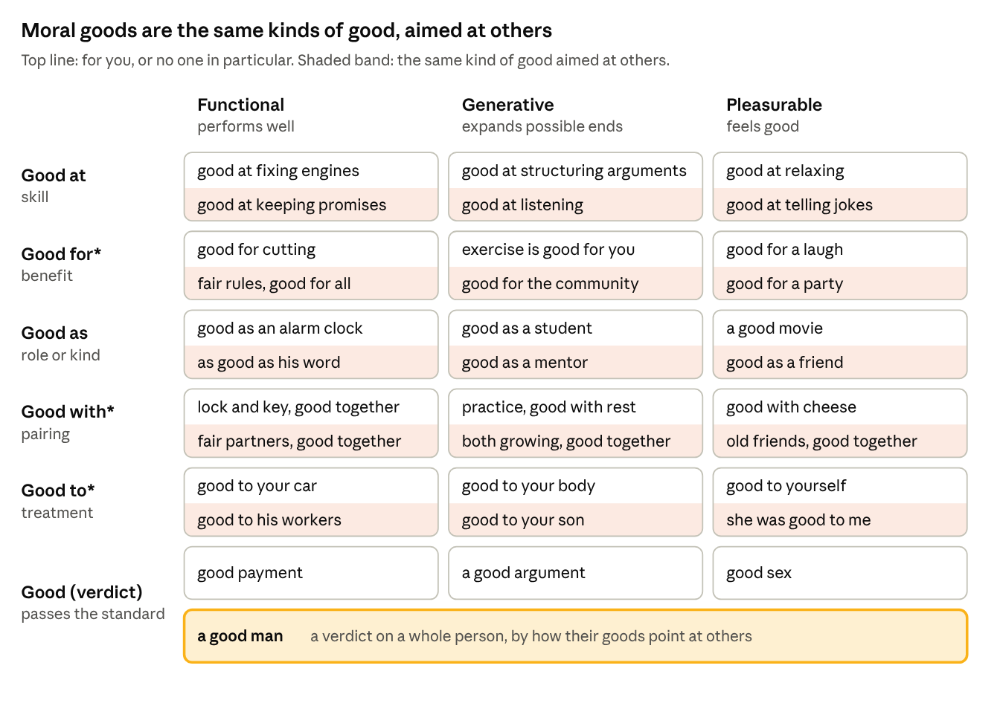
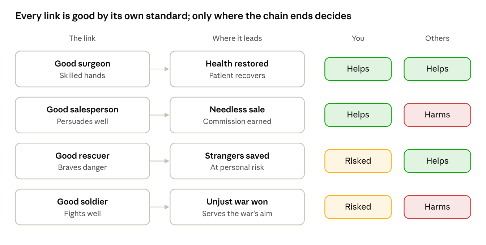
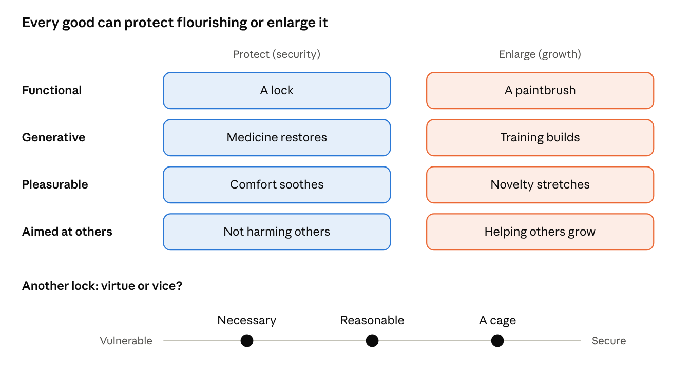

# The uses of "good"

The word compresses many uses, each tied to a different end. Aristotle argued "good" is said in as many ways as "being" (*Nicomachean Ethics* I.6). The chart below was built independently here, and Georg Henrik von Wright's *The Varieties of Goodness* (1963) turns out to sort it in a similar way, which is some evidence the structure is real rather than invented. It varies along three dimensions: a grammatical form (good at, for, as, with, to, or a verdict), the kind of good (functional, generative, or pleasurable), and its direction, whose flourishing it serves. Every good is instrumental in shape, a link that serves something: the Functional column holds goods judged by how well they perform their function, whatever comes after, and the other two name what the function serves. Moral goods are not a fourth kind but any of the three aimed at others; fairness and honesty, for example, are functional goods of consistency. The chart shows them as the shaded band in each box. This direction differs from direction of fit: it asks whom a good serves, not what changes on a mismatch. Every combination occurs, and every evaluative use is end-relative, which is the Hypothetical Imperative axiom spelled out.

Summarized under Compression in [Axioms](axioms.md#compression).

Written as templates, every form relates X to something else, always within a context. Only the verdict leaves that something out:

- X is good **at** Y (skill)
- X is good **for** Y (benefit)
- X is good **as** a Y (role or kind)
- X and Y are good **together** (fit). Skill uses like "good with tools" or "good with kids" belong under "good at."
- X is good **to** Y (treatment)
- **X is good** (verdict): the only form with no Y, so its standard is hidden

*forms of good × the ends they serve · orange: moral judgment, where blame and praise live*

**\* More than one sense.** The starred prepositions each carry more than one relation; the row subtitles name the main one.

- **Good for:** purpose or benefit (good for cutting, good for you), or a comparison class (good for a movie, warm for October). The comparison class grades against the kind's average rather than its ideal, often as a backhanded compliment (good for a made-for-TV movie), so it is a cousin of "as."
- **Good with:** pairing (good with cheese); handling, which is really a skill and belongs under "good at" (good with kids); or acceptance, the mind settled with something (I'm good with that, good with oneself).
- **Good to:** treatment (she was good to me, good to your body). Before a verb, "to" is a different word, and the phrase usually belongs to another row: suitability, close to "for" (good to eat, good to go, good to rule), or a verdict on the action itself (good to do, good to know, good to see you). Several are also stock phrases, listed with the performative uses below.

* **The orange cell is where blame and praise live, and it needs further analysis.** "What a good man" is the plainest bare verdict on another mind: a judgment of the whole person with no standard attached. It isn't the only one: weak, loser, weird, and crazy judge the whole person too, with their standards hidden (strength, status, normality, sanity), and none of those standards is moral. Other cells judge people within a named domain (a good soldier, good at listening, good to me), but a domain isn't always a standard. "Good at golf" carries its bar in the score; "good at listening" leaves the bar, what counts as being heard, to the speaker, so it is factual where that bar is shared and observable and a judgment where it isn't. Without a standard, the verdict slides from "you did good" to "you are good," which makes it the grammatical home of basic desert. Its obedience variant, "good boy," confirms that someone met others' expectations, which may or may not serve anyone's flourishing. When they do, it is genuine moral confirmation; when they don't, it confirms conformity, the path the diagram warns about. Here moral goodness and obedience can masquerade as each other. Ethics lives in every good aimed at others; this cell is where it becomes a judgment of a person. Without basic desert, praise and blame become tools and signals, and they work best aimed at the process rather than the person: praise reinforces what serves flourishing, and blame signals when accountability and change are needed. Aimed at the person, both push toward the security side. Children praised for being smart rather than for their effort start avoiding hard tasks (Claudia Mueller and Carol Dweck, 1998), and blame that lands on the self feeds rumination or conformity. Research on shame and guilt agrees: guilt about an act tends to prompt repair, while shame about the self tends to prompt hiding (June Tangney). So being explicit about one's standards does double duty: it makes a verdict checkable, and it keeps the verdict on the act. Strawson's "Freedom and Resentment" and Pereboom's reply are the place to continue the analysis.
* **Standard and scope decide whether a verdict on a person is justified.** A verdict on a person is justified when its standard and scope are clear, from the words or the context. "What a good man," said right after he returns a lost wallet, has a clear standard even though the grammar hides it. Strawson helps here: reactive attitudes respond to one standard, the goodwill or ill will others show us. Relationships share that standard, which is why gratitude and resentment usually make sense and "she was good to me" is uncontested. Third-party verdicts are where standards go missing. Scope has two dimensions: domain (as a friend, at work, to me) and time (these ten years, so far). Unbounded time is where basic desert creeps back. "He *is* good" claims something fixed about a person, a prediction about a system that, as Emergence says, has to be run to be known. "He's been a good friend these ten years" judges a pattern and stays revisable, a verdict on character Pereboom can accept without basic desert. The bare verdict hides both standard and scope, and that gap is where basic desert lives.
* **Validity and obedience are verdicts, not ends.** "Good money" confirms it counts as money at all; counterfeit isn't bad money, it isn't money. "Good boy" confirms conduct met a standard.
* **Roles are instrumental.** A role exists for an end: a soldier for war, a doctor for health. Instrumental goodness is independent of the end's worth, so a good soldier can serve an unjust war.
* **Goods chain together.** A doctor's role is instrumental, but what it produces, health, is generative.
* **Being good at something is being a good one of it.** "Good at golf" means "a good golfer": consistency with the methods that produce good outcomes, judged over many attempts rather than one. Open-ended activities, like organizing frameworks, still have ends; they are just still developing.
* **Games are chosen friction.** Bernard Suits defined a game as the voluntary attempt to overcome unnecessary obstacles, chosen for the sake of stimulation and flow, with pleasure as the signal.
* **Health is generative** for a person, and so are the senses: eyes don't serve one task, they open a whole dimension of possible ends. "Good eyes" judges them by a functional standard, how well they see, but the end they serve is generative.
* **Pleasure and desire can come apart.** One can desire what doesn't feel good and enjoy what was never wanted.
* **Von Wright's categories map onto the ends:** instrumental and technical onto functional; beneficial, medical, and welfare onto generative; hedonic onto pleasurable. He treats moral goodness as derived, which fits reading moral goods as a direction rather than a kind.

**The verdict form hides its standard.** Every other form names at least its domain in the grammar: good *at* golf, good *for* you, good *as* a mentor. A bare verdict drops it, so the listener supplies whose standard is meant, usually the speaker's. In the verdict row, contestability rises from left to right: payment (a conventional standard), argument (a logical one), sex (an experiential one), and in the bar below them, a good man (the judge's standards).

The gradient doesn't always hold. Pleasure is subjective but hard to contest, since each person has authority over their own experience ("good food"). Functional verdicts become contested when the end is ("a good plan"). Moral verdicts can be uncontested when the judge is the one affected ("she was good to me"). The real variable is who holds the standard relative to whose ends are at stake:

- **Fixed end, shared standard:** low contestability (good payment, a good knife).
- **A first-person judge of their own ends:** subjective but authoritative (good food, good to me).
- **A third party judging by their own expectations:** most contestable (good boy).

This generalizes the sufferer's authority: whoever's flourishing is at stake has authority over verdicts about it. The orange cell is contested because the one judged, the ones affected, and the one judging can all be different people.

**Correspondence or cheer.** The orange cell can hold both main theories of moral verdicts. Speaker relativism reads "what a good man" as a claim that his conduct matches the speaker's values, which can be true or false. Expressivism (A.J. Ayer, Simon Blackburn, Allan Gibbard) reads it as expressing an attitude, closer to "him, yay!" Hybrid theories (Michael Ridge, Daniel Boisvert) hold that verdicts usually do both. This framework leans toward speaker relativism, because correspondence can be checked.

- **The test:** ask by what standard. If the speaker can name the values and would revise the verdict when shown the conduct doesn't match, it works as a claim. If no evidence could change it, it works as a cheer.
- **Cheers serve belonging.** A verdict that can't be wrong is felt certainty; a verdict whose job is signaling a side serves belonging, the conformity path's aim.
- **It cuts across sides.** Political scientists call this expressive responding. In one study, paying people for accurate answers shrank partisan gaps in their factual claims, among Democrats and Republicans alike. Praise and condemnation of polarizing figures can both be cheers in disguise.

**Performative uses sit in the chart too.** Almost every performative use is a verdict from the chart, spoken as an act; J.L. Austin called these speech acts, doing something by saying something. The last two are verdicts that have lost their standard entirely.

| Performative use | Where it sits in the chart | What's happening |
| --- | --- | --- |
| Agreement ("sounds good," "I'm good with that") | Verdict or *with* × functional | The plan passes the speaker's standard or fits their purposes |
| Endorsement ("Good." after the trash is taken out) | Verdict × functional, or on the person | Aimed at the task, it's a functional verdict; aimed at the person, it's the orange cell used as a signal |
| Social pressure ("good people don't complain") | Verdict on a person: the orange cell | The orange cell used as a tool, its standard hidden |
| Stock phrases ("good to go," "good to know," "good to see you") | Verdict on an action, or for (good to go is roughly good for going) | A readiness signal, an acknowledgment, a greeting; the evaluation can still be live ("it's good to know CPR") |
| Intensifier ("a good hour," "a good deal," "good and ready") | Verdict × functional, worn down | "A good hour" meant a full, genuine hour: validity faded into emphasis. "Good and ready" means thoroughly ready, like "good and tired" |
| Exclamation ("good God," "good grief") | No cell: fully worn down | Pure expression, the cheer end of the spectrum |

Linguists call this wearing away semantic bleaching. "Very" comes from the Old French *verai*, meaning "true," and traveled the same road from validity to emphasis.

**A spectrum of standard visibility.**

1. **Named standard:** good *at* golf, good *for* you, good *as* a mentor.
2. **Hidden standard:** the verdict row, where the listener supplies whose standard is meant.
3. **Performed verdict:** agreement, endorsement, social pressure; the act matters more than the evaluation.
4. **Lost standard:** intensifiers and exclamations; the evaluation has drained out.

Social pressure lives at step 3: a moral verdict performed as if it needed no standard, the verdict form's hidden standard used deliberately. Performative uses compress a form, an end, and an act at once, and with enough repetition the evaluation can wear away, leaving only the act.

**One relation.** The forms and ends aren't separate realms. They map one relation: something is good as a kind, at an activity, for someone, toward an end, by someone's standard. Each grammatical form says one of those places out loud, and the bare verdict says none, which is why it sounds like a property things have on their own (Plato's Form of the Good, G.E. Moore's non-natural property). Judith Jarvis Thomson's *Normativity* (2008) argues that all goodness is goodness in a way.

**Flourishing is the final measure.** Goods chain together, and the chains end in someone's flourishing, so flourishing measures every category rather than belonging to one. Each link keeps its own standard: a good soldier is good as a soldier even in an unjust war, and a knife used in a murder still cuts well. Flourishing judges where the chain leads, twice: for the one acting and for others.

*four chains, every link good by its own standard · judged for you and for others*

The chains land in different places, and the framework already names each. Helping both is the aim. Helping oneself by harming others is injustice. Risking oneself to help others is sacrifice, beyond duty. The soldier harms others and risks himself: Jonathan Shay called the damage of violating one's own code moral injury, but it is a risk, not a certainty, since minds are weakly emergent and no one knows in advance how they will react. No local standard tells which row a chain is in; only its end does.

**Protect or enlarge.** A good can serve flourishing by protecting it or by enlarging it, and every kind of good splits that way. Which matters more depends on precarity, since the mean moves with it: a lock is right for someone exposed to danger and a cage for someone already safe.

*protecting vs enlarging flourishing · precarity sets the weighting*
